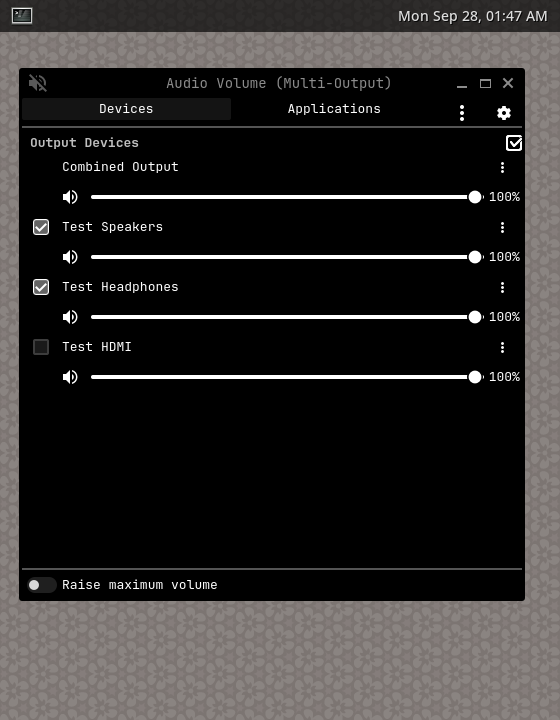
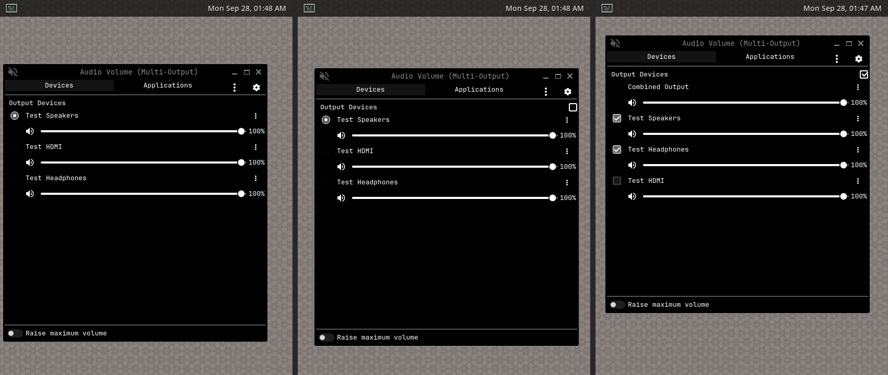

# iris-volume

**English** · [Türkçe](README.tr.md)

A fork of KDE Plasma's **Audio Volume** applet (`org.kde.plasma.volume` from
[plasma-pa](https://invent.kde.org/plasma/plasma-pa)) that can play audio on
several output devices at once. It installs as a separate widget,
`io.github.lckt0.volume` ("Audio Volume (Multi-Output)"), so the stock applet
keeps working and updating alongside it.



> **A note before you start:** iris-volume was originally built for my own setup and daily use, and later shared in case it helps someone else. It reflects my own hardware, tools and preferences, so it may not fit every system or workflow. Issues and suggestions are welcome, but please keep that in mind.

Left to right: stock plasma-pa, this fork with multi-output off, and with
multi-output on.



## Origin

Forked from plasma-pa **6.7.5** and rebased onto **6.8.0** (current version
6.8.0.1). The full difference from the upstream applet is in
[`fork/upstream-to-fork.patch`](fork/upstream-to-fork.patch).

What changed compared to the stock applet:

- **Play on Multiple Devices.** A checkbox in the *Output Devices* header (and
  in the context menu) turns output rows from radio buttons into checkboxes.
  When two or more outputs are checked, the applet loads a
  `module-combine-sink` in pipewire-pulse, makes it the default device and
  shows a *Combined Output* row with its own volume slider. Unchecking down to
  one output removes the combined sink again.
  - The combined sink is created on demand by a small helper script
    (`contents/code/multi-output.sh`, run through `pactl`). Nothing polls in
    the background.
  - Switching the set of devices builds the new combined sink before removing
    the old one, so audio does not fall back to a random device in between.
  - A checked device that disconnects (for example Bluetooth headphones) is
    re-attached automatically when it comes back.
  - Optional latency compensation keeps slower outputs (Bluetooth) in sync
    with faster ones.
  - The combined sink's internal per-device streams are hidden from the
    *Applications* tab.
- **Level meters only while the popup is open.** The stock applet keeps its
  peak-meter capture streams alive after the popup closes, which keeps the
  sound card and the PipeWire graph busy while idle. The fork only meters
  while the popup is expanded, and the meters can be turned off
  (`levelMeters`).
- **Open Audio Patchbay (qpwgraph)** entry in the context menu.

New settings in `contents/config/main.xml`: `multiOutputEnabled`,
`multiOutputSinks`, `multiOutputLatencyCompensate`, `levelMeters`.

## Installation

### Requirements

- KDE Plasma 6.8 with plasma-pa 6.8.x. The fork imports plasma-pa's private
  QML module (`org.kde.plasma.private.volume`), which has no stable API, so it
  is tied to one plasma-pa minor version.
- PipeWire with `pipewire-pulse`, and `pactl` (libpulse)
- `plasma5support`, `kitemmodels`, `kde-cli-tools` (`kstart`); optionally `qpwgraph`

### Arch Linux (package)

Build and install the package with the included `PKGBUILD`:

```sh
git clone https://github.com/lckt0/iris-volume.git
cd iris-volume
makepkg -si
```

The `PKGBUILD` downloads the tagged release (`v<pkgver>`) from GitHub and
installs the widget to `/usr/share/plasma/plasmoids/io.github.lckt0.volume`.
It also links plasma-pa's translations to the new widget id.

### Manual installation

```sh
git clone https://github.com/lckt0/iris-volume.git
cd iris-volume
mkdir -p ~/.local/share/plasma/plasmoids
cp -r package ~/.local/share/plasma/plasmoids/io.github.lckt0.volume
chmod +x ~/.local/share/plasma/plasmoids/io.github.lckt0.volume/contents/code/multi-output.sh
```

### Adding the widget

Right-click a panel → **Add or Manage Widgets** → **Audio Volume (Multi-Output)**,
then remove the stock **Audio Volume** widget if you no longer want both.

To replace an existing stock volume widget in place and keep its settings,
`fork/switch-panel.sh` rewrites the `plugin=` line in
`~/.config/plasma-org.kde.plasma.desktop-appletsrc` (dry run by default,
`--apply` to write after making a backup, `--revert` to go back). Restart
plasmashell afterwards (`systemctl --user restart plasma-plasmashell`).

### Usage

Open the widget and tick the checkbox at the right of the **Output Devices**
header, or use **Play on Multiple Devices** from the right-click menu. Then
check the outputs that should play together.

## Uninstallation

1. If a combined output is active, turn **Play on Multiple Devices** off first
   so the combined sink is removed (it also disappears when pipewire-pulse
   restarts).
2. If you used `fork/switch-panel.sh`, switch the panel back to the stock
   widget and restart plasmashell:

   ```sh
   fork/switch-panel.sh --revert
   systemctl --user restart plasma-plasmashell
   ```

   Otherwise remove **Audio Volume (Multi-Output)** from the panel and add the
   stock **Audio Volume** widget again.
3. Remove the files:

   ```sh
   sudo pacman -Rns plasma-applet-lckt0-volume                 # package install
   rm -r ~/.local/share/plasma/plasmoids/io.github.lckt0.volume  # manual install
   ```

The widget's settings are stored in the panel configuration and disappear with
the widget. Backups written by `switch-panel.sh --apply`
(`~/.config/plasma-org.kde.plasma.desktop-appletsrc.bak-lckt0-volume-*`) can be
deleted.

## Development

```
package/   the applet (KPackage layout)
fork/      upstream-to-fork.patch, make-patch.sh, switch-panel.sh
test/      tests
```

- `test/test-helper.sh` unit-tests `multi-output.sh` against a fake `pactl`.
- `test/run-isolated-pw.sh <out-dir>` starts a private PipeWire,
  WirePlumber (no hardware monitors) and pipewire-pulse with null sinks, a
  private D-Bus session and a headless weston, then drives the applet through
  `plasmawindowed` and checks the combined-sink behaviour. It does not touch
  the running audio graph. Set `UPSTREAM_APPLET` to a plasma-pa `applet/`
  directory to also render the stock applet for comparison.
- `test/run-headless.sh <stock|multi> <out.png>` renders the applet in a
  headless weston with a stub helper.

To rebase onto a new plasma-pa release, see the header of
`fork/make-patch.sh`.

## License

The applet is derived from KDE's plasma-pa and keeps its licenses and
copyright headers. Upstream files are
`GPL-2.0-only OR GPL-3.0-only OR LicenseRef-KDE-Accepted-GPL` (and
`LGPL-2.0-or-later` for `HorizontalStackView.qml`); the new files
(`MultiOutput.qml`, `multi-output.sh`) are `GPL-2.0-or-later`. License texts
are in [`LICENSES/`](LICENSES).
